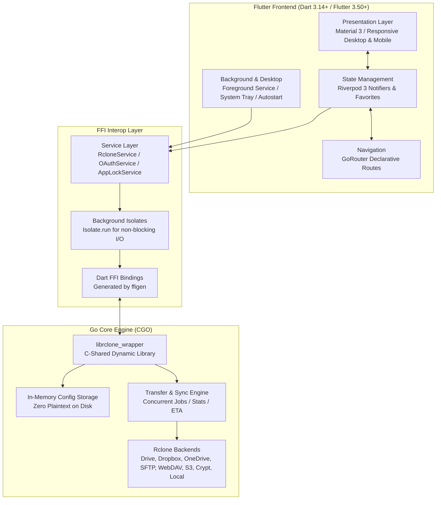

# UnifyCloud ☁️

**UnifyCloud** is a free and open-source (GPL-3.0), cross-platform multi-cloud storage manager and file synchronizer built with **Flutter (Material 3)** and powered by an embedded native **Go (Rclone)** engine via high-performance **Dart C-FFI**.

It aggregates **Google Drive**, **Dropbox**, **Microsoft OneDrive**, **Nextcloud / WebDAV**, **SSH / SFTP**, **Amazon S3 (and S3-compatible)**, **Local Filesystem**, and **client-side AES-256 Crypt Vaults** into a single unified desktop and mobile experience.

---

## 🌟 Key Features

- **Unified Dashboard & Pinned Favorites**: Monitor aggregate and per-drive storage quotas in real time, pin frequently used files or folders to the **Home** screen for one-tap access, and create encrypted vaults directly from any remote card (**Create Vault Here**).
- **Multi-Cloud File Explorer & Dual-Pane Commander**: Browse local and remote storage with an adaptive compact toolbar, Disk Chooser (with `AES-256` E2EE badge), unified file & folder upload dialog, multi-selection batch operations, customizable long-press gestures, cross-pane/folder drag-and-drop, and protected back navigation.
- **Direct Cloud-to-Cloud Transfers**: Stream files directly between providers (e.g., Google Drive to OneDrive or Dropbox to SFTP) in memory without temporary local disk copies, backed by a multi-cloud clipboard and real-time Transfer Manager (speed, ETA, queue, cancel, retry).
- **Automated Folder Synchronization**: Schedule incremental backups (`copy`) or 1:1 mirror syncs (`sync`) between local folders and cloud remotes, complete with quick OS folder presets and **Sync All**.
- **Zero-Plaintext In-RAM Security, Crypt & App Lock**: Encrypted OS Keystore/Keychain persistence decrypted only into Go RAM, client-side Rclone Crypt AES-256 vaults, and a 6-digit PIN (salted PBKDF2-HMAC-SHA256) + Biometric App Lock gate.
- **Background Execution & Desktop Tray**: Android Foreground Service keeps transfers and sync alive in the background; desktop builds support minimizing to the **System Tray** (with live transfer speed status), `--background` / `--minimized` flags, and Linux XDG Autostart.
- **Multi-Language Support**: Available in **6 languages** (English, Italian, French, Polish, Spanish, and Arabic) or automatic system locale.

---

## 🏗️ Architecture & Tech Stack



- **Frontend**: Flutter `3.50+` (Dart `3.14+`) with `material_ui` (Material 3), `flutter_riverpod` 3, and `go_router`.
- **Native Bridge & Core**: `dart:ffi` (`ffigen`) calling a Go `1.26+` CGO shared library embedding `rclone` (`v1.75+`).
- **Platform Services**: `flutter_secure_storage`, `local_auth`, `flutter_background_service`, `tray_manager`, and `window_manager`.

---

## 🚀 Build & Installation

Everything you need to install UnifyCloud (Android via F-Droid or APK, Linux via Flatpak/Flathub or native bundle, Windows, macOS, iOS), configure Desktop Tray/Autostart, or build from source is documented in the Wiki:

👉 **[Installation & Build Guide](docs/wiki/Installation-Guide.md)** · ([GitLab Wiki](https://gitlab.com/leonardobani/unifycloud/-/wikis/Installation-Guide))

---

## 📚 Documentation & User Guides

Full guides, walkthroughs, and configuration details live in [`docs/wiki/`](docs/wiki/) and on the **[GitLab Wiki](https://gitlab.com/leonardobani/unifycloud/-/wikis/home)**—kept there so nothing is duplicated here:

- 🏠 **[Wiki Home](docs/wiki/home.md)** ([GitLab](https://gitlab.com/leonardobani/unifycloud/-/wikis/home)): Overview, capabilities, and system architecture.
- 📦 **[Installation Guide](docs/wiki/Installation-Guide.md)** ([GitLab](https://gitlab.com/leonardobani/unifycloud/-/wikis/Installation-Guide)): End-user installs, desktop tray/autostart, prerequisites, and building from source.
- ☁️ **[Configuring Drives](docs/wiki/Configuring-Drives.md)** ([GitLab](https://gitlab.com/leonardobani/unifycloud/-/wikis/Configuring-Drives)): Connecting Google Drive, OneDrive, Dropbox, Nextcloud/WebDAV, SFTP, S3, Local Disk, and Crypt E2EE vaults.
- 🔑 **[OAuth 2.0 Setup Guide](docs/wiki/OAuth-Setup-Guide.md)** ([GitLab](https://gitlab.com/leonardobani/unifycloud/-/wikis/OAuth-Setup-Guide)): 3-tier auth model, custom Client IDs/Secrets, and `--dart-define` build-time injection.
- 🔄 **[Setting Up Sync](docs/wiki/Setting-up-Sync.md)** ([GitLab](https://gitlab.com/leonardobani/unifycloud/-/wikis/Setting-up-Sync)): Scheduled incremental backups (`copy`), mirror sync (`sync`), folder presets, and **Sync All**.
- 📁 **[File Management & Transfers](docs/wiki/File-Management-and-Transfers.md)** ([GitLab](https://gitlab.com/leonardobani/unifycloud/-/wikis/File-Management-and-Transfers)): Pinned favorites, unified file/folder uploads, multi-selection, long-press gestures, Dual-Pane Commander Mode, cloud-to-cloud transfers, and share links.
- ❓ **[Troubleshooting & FAQ](docs/wiki/Troubleshooting-and-FAQ.md)** ([GitLab](https://gitlab.com/leonardobani/unifycloud/-/wikis/Troubleshooting-and-FAQ)): Port `53682` conflicts, Android battery optimization, Flatpak/Keyring tips, and supported languages.

---

## 🔒 Security

UnifyCloud keeps all cloud credentials encrypted in your OS Keystore/Keychain and injects them into Go RAM only—never writing plaintext config files to disk—alongside client-side AES-256 Crypt vaults and a salted PBKDF2-HMAC-SHA256 6-digit PIN / Biometric App Lock.

👉 Read the full security architecture in **[Security & App Lock](docs/wiki/Security-and-App-Lock.md)** · ([GitLab Wiki](https://gitlab.com/leonardobani/unifycloud/-/wikis/Security-and-App-Lock))

---

## 🧪 Testing & Verification

```bash
# Static analysis
dart analyze

# Flutter unit and widget tests
flutter test

# Go CGO backend tests
cd go_backend && go test ./...
```

---

## 📂 Project Structure

```
unifycloud/
├── android/                   # Android Gradle project, NDK buildGoAndroid hook & manifest
├── assets/icons/              # App logo and desktop system tray icon
├── docs/wiki/                 # Official GitLab Wiki documentation source
├── fastlane/metadata/         # F-Droid / Play store metadata & screenshots
├── go_backend/                # Embedded Go Rclone CGO wrapper & tests
├── ios/ & macos/ & windows/   # Native platform runners & library integration
├── lib/
│   ├── main.dart              # Entry point, tray/autostart/background init & Riverpod root
│   ├── l10n/                  # ARB files & generated localizations (ar, en, es, fr, it, pl)
│   └── src/
│       ├── ffi/               # Generated Dart CGO bindings (ffigen)
│       ├── models/            # Cloud, Favorite, Settings, SyncRule & Transfer models
│       ├── providers/         # Riverpod 3 notifiers (Accounts, Explorer, Favorites, Sync, Transfers, AppLock)
│       ├── router/            # GoRouter declarative routes
│       ├── services/          # Rclone, OAuth, SecureConfig, AppLock, FileOpener, Tray, Autostart & Background
│       ├── ui/                # Material 3 theme, screens & widgets
│       └── utils/             # Token sanitization & URL launch helpers
├── linux/                     # Linux CMake configuration & Go library bundling
├── packaging/                 # F-Droid recipe & Flatpak / Flathub manifests
├── scripts/                   # Cross-compilation & l10n helper scripts
├── test/                      # Unit, widget, and FFI integration test suite
├── ffigen.yaml                # FFI binding generator configuration
└── pubspec.yaml               # Flutter dependencies, SDK constraints & l10n config
```

---

## 📄 License

This project is licensed under the **GNU General Public License v3.0 (GPL-3.0)** - see the [LICENSE](LICENSE) file for details.

Copyright (C) 2026 Leonardo Bani.
