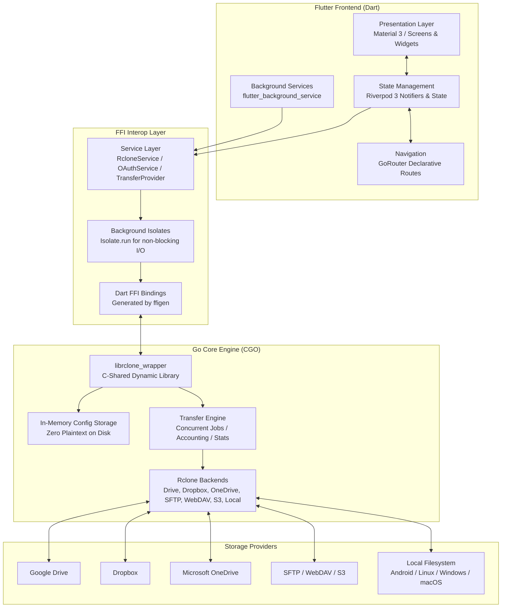

# UnifyCloud ☁️

**UnifyCloud** is a cross-platform, multi-cloud storage manager and file synchronizer built with **Flutter** and powered by an embedded native **Go (Rclone)** engine via high-performance **Dart FFI**.

It seamlessly aggregates cloud storage providers (**Google Drive**, **Dropbox**, **Microsoft OneDrive**, **SFTP**, **WebDAV**, **Amazon S3**, and **Local Filesystem**) into a single, responsive, and secure desktop and mobile experience.

---

## 🌟 Key Features

- **Unified Multi-Cloud Dashboard**: Connect multiple cloud accounts simultaneously and monitor aggregate storage capacity alongside per-drive usage in real time.
- **Native Embedded Rclone Engine**: Powered by a custom-compiled Go CGO shared library leveraging Rclone's battle-tested synchronization and transfer core.
- **Zero-Plaintext In-RAM Security**: Sensitive OAuth tokens and cloud passwords are stored encrypted in the OS Keychain / Android Keystore / Linux Secret Service (`flutter_secure_storage`). Configurations are decrypted directly into RAM storage in the Go core—credentials are never written in plaintext to disk.
- **Direct Cloud-to-Cloud Transfers**: Copy or move files directly between different cloud providers (e.g., Google Drive to OneDrive or Dropbox to SFTP) with automatic background queuing and clipboard support.
- **Real-Time Transfer Manager**: Track transfer speeds, transferred bytes, and estimated time remaining (ETA) via a bottom sheet and floating progress bar, with support for cancellation and retry.
- **Background Transfer Execution**: Transfers continue running even when the app is minimized or backgrounded, using Android Foreground Services and native OS background tasks.
- **True Local Disk Browsing**: Full filesystem exploration (`/storage/emulated/0` on Android, root `/` on Linux/macOS, drive letters on Windows) with disk quota detection.
- **Flexible OAuth2 Authentication**: Sign in to Google Drive and other services using either official built-in Rclone client credentials or your own custom Client ID and Secret.

---

## 🏗️ Architecture & Tech Stack



### Core Technologies
- **Frontend / Framework**: Flutter (Dart 3.13+) with Material 3 design and responsive layouts.
- **State Management**: [Riverpod 3](https://riverpod.dev) using modern class-based `Notifier` patterns.
- **Routing**: [GoRouter](https://pub.dev/packages/go_router) with deep linking and history support.
- **Native Bridge**: `dart:ffi` with automated C header bindings via `ffigen`.
- **Core Backend**: Embedded [Rclone](https://rclone.org) written in **Go 1.22+**, compiled into native shared libraries (`.so`, `.dll`, `.dylib`, `.a`).
- **Secure Persistence**: System Keychain / Keystore encryption via `flutter_secure_storage`.
- **Background Execution**: `flutter_background_service` with foreground notification synchronization.

---

## 📋 Prerequisites

Before building or running UnifyCloud, ensure your development machine has:

1. **Flutter SDK**: Version `3.13.3` or later ([Install Flutter](https://docs.flutter.dev/get-started/install)).
2. **Go Compiler**: Version `1.22` or later ([Install Go](https://go.dev/doc/install)).
3. **C/C++ Build Toolchain**:
   - **Linux**: GCC/Clang, CMake, Ninja, `pkg-config`, `libgtk-3-dev`.
   - **Android**: Android SDK (API 34+), Android NDK (`r28` or later), CMake.
   - **Windows**: Visual Studio 2022 (with Desktop C++ workload) or MinGW-w64.
   - **macOS / iOS**: Xcode 15+ and Command Line Tools.

---

## 🚀 Build & Installation Guide

### 1. Linux Desktop

#### Step 1: Compile the Go Shared Library
```bash
cd go_backend
go build -buildmode=c-shared -o librclone_wrapper.so main.go
cd ..
```

#### Step 2: Run in Debug Mode
```bash
flutter run -d linux
```

#### Step 3: Build Release Bundle
```bash
flutter build linux --release
```
The executable bundle will be located at:
```
build/linux/x64/release/bundle/
```

---

### 2. Android (Mobile)

#### Step 1: Set Android SDK and NDK Paths
Ensure your `android/local.properties` contains your Android SDK location:
```properties
sdk.dir=/path/to/android-sdk
```
Or configure it globally:
```bash
flutter config --android-sdk /path/to/android-sdk
```

#### Step 2: Cross-Compile Native Go Backend for Android
Run the automated build script to cross-compile `librclone_wrapper.so` for all supported Android ABIs (`arm64-v8a`, `armeabi-v7a`, `x86_64`):

**On Linux/macOS:**
```bash
bash scripts/build_go_android.sh
```

**On Windows:**
```cmd
scripts\build_go_android.bat
```

The compiled `.so` files will be placed into `android/app/src/main/jniLibs/`.

#### Step 3: Build Release APK
```bash
flutter build apk --release
```
The output APK is generated at:
```
build/app/outputs/flutter-apk/app-release.apk
```

> [!TIP]
> To generate smaller, architecture-specific APKs (~50MB instead of universal fat APK):
> ```bash
> flutter build apk --release --split-per-abi
> ```

#### Step 4: Install on Connected Device
```bash
adb install -r build/app/outputs/flutter-apk/app-release.apk
```

---

### 3. Windows Desktop

#### Step 1: Compile the Go DLL
```cmd
cd go_backend
go build -buildmode=c-shared -o librclone_wrapper.dll main.go
cd ..
```

#### Step 2: Run in Debug Mode
```cmd
flutter run -d windows
```

#### Step 3: Build Release Executable
```cmd
flutter build windows --release
```
The output bundle will be generated under `build\windows\x64\runner\Release\`.

---

### 4. macOS & iOS

#### macOS:
```bash
cd go_backend
go build -buildmode=c-shared -o librclone_wrapper.dylib main.go
cd ..
flutter run -d macos
```

#### iOS:
```bash
bash scripts/build_go_ios.sh
flutter run -d ios
```

---

## 📖 User Guide & Walkthrough

### Connecting a Cloud Provider
1. On the **Home** screen, tap **"Collega Nuovo Cloud"** (Add Cloud).
2. Select your provider:
   - **Google Drive**: Choose either **Rclone Client ID** (instant one-click OAuth login via local loopback server) or **Client ID Personale** (enter custom Google Cloud Console OAuth credentials).
   - **Dropbox**: Instant OAuth authorization with built-in or custom client credentials.
   - **Microsoft OneDrive**: Personal or Business Microsoft account OAuth login.
   - **SFTP**: Enter host, port, username, and password.
   - **WebDAV / Nextcloud**: Enter WebDAV server endpoint URL and credentials.
   - **Amazon S3**: Enter S3 endpoint, Access Key ID, and Secret Access Key.
   - **Disco Locale**: Opens the device's native filesystem (`/storage/emulated/0` on Android, root `/` on desktop).
3. Tap **"Salva e Connetti"**. The remote is validated, credentials are encrypted into the system Keychain, and the drive appears in your dashboard.

### File Exploration & Navigation
- **Breadcrumbs Bar**: Tap any segment in the breadcrumbs trail to jump directly to parent folders.
- **Sorting & View Modes**: Toggle between List View and Grid View, and sort items by Name, Size, or Date.
- **Search**: Real-time filtering within the current folder.
- **Context Menu**: Tap the 3-dots menu on any file or directory to:
  - **Scarica** (Download): Automatically downloads to the system's standard Downloads folder.
  - **Copia** (Copy) / **Taglia** (Move): Copies file reference to the multi-cloud clipboard.
  - **Elimina** (Delete): Confirms and deletes the item.
  - **Dettagli** (Details): View file size, path, MIME type, and last modification timestamp.

### Multi-Cloud Copy & Paste
1. Navigate to any file on **Cloud A** (e.g., Google Drive) and select **Copia** or **Taglia**.
2. A floating clipboard banner appears at the bottom: *"File pronto per la copia: report.pdf"*.
3. Navigate to any folder on **Cloud B** (e.g., Dropbox or Local Drive).
4. Tap **"Incolla qui"** (Paste here).
5. The transfer begins immediately in the background, streaming directly between remotes.

### Monitoring Transfers
- Active transfers display a floating bar at the bottom with real-time transfer speed (`MB/s`) and percentage.
- Tap the bar to expand the full **Transfer Manager Sheet** to view queued, completed, and active transfers, or to cancel running jobs.

---

## 🧪 Testing & Verification

UnifyCloud includes a full unit, widget, and FFI integration test suite.

### Run Static Analysis
```bash
dart analyze
```

### Run All Automated Tests
```bash
flutter test
```

### Key Test Coverage:
- **`test/storage_quota_test.dart`**: Unit tests for `StorageQuota` calculations, byte formatting, JSON serialization, aggregate statistics, and UI progress indicators.
- **`test/rclone_service_test.dart`**: FFI integration tests verifying dynamic remote creation, in-memory config management, directory listing, CRUD, and quota interrogation.
- **`test/transfer_test.dart`**: Transfer job models, speed/ETA formatters, and cancellation mechanics.
- **`test/add_cloud_dialog_test.dart`**: OAuth service credentials, Client ID selection mode, and modal UI rendering.
- **`test/expandable_error_box_test.dart`**: Interactive error box expansion, smooth scrolling, and clipboard error copying.

---

## 📂 Project Structure

```
unifycloud/
├── android/                   # Android native project and Gradle configuration
│   ├── app/build.gradle.kts   # Native NDK task hook & signing config
│   └── src/main/AndroidManifest.xml # Storage, Foreground Service & Internet permissions
├── go_backend/                # Core Go Rclone CGO implementation
│   ├── main.go                # Exported CGO functions (C ABI) & memory storage
│   ├── go.mod / go.sum        # Go dependencies (Rclone core & backends)
│   └── librclone_wrapper.so   # Built C-shared library for Linux desktop
├── lib/
│   ├── main.dart              # Application entry point & Riverpod root
│   └── src/
│       ├── ffi/               # Low-level Dart CGO bindings (generated via ffigen)
│       ├── models/            # Data models (CloudItem, CloudRemote, StorageQuota, TransferJob)
│       ├── providers/         # Riverpod 3 notifiers (Accounts, Explorer, Transfers, Clipboard)
│       ├── router/            # GoRouter declarative navigation
│       ├── services/          # RcloneService, OAuthService, SecureConfigService, BackgroundService
│       ├── ui/
│       │   ├── screens/       # HomeScreen, FileExplorerScreen, SettingsScreen, MainScaffold
│       │   ├── theme/         # Color palettes, dark theme, provider icons & styling
│       │   └── widgets/       # AddCloudDialog, BreadcrumbsBar, FileContextMenu, TransferPanel
│       └── utils/             # Token normalization & helper utilities
├── linux/                     # Linux CMake configuration with Go library bundling
├── scripts/                   # Automated cross-compilation scripts
│   ├── build_go_android.sh    # Android NDK cross-compilation for arm64/arm/x86_64
│   ├── build_go_android.bat   # Windows batch equivalent for Android
│   └── build_go_ios.sh        # iOS device and simulator cross-compilation
├── test/                      # Comprehensive unit, widget, and integration test suite
├── ffigen.yaml                # FFI binding generator configuration
└── pubspec.yaml               # Flutter dependencies and assets configuration
```

---

## 🔒 Security Best Practices

- **Zero Plaintext Token Storage**: Credentials are never written to unencrypted INI files or local storage.
- **Protected Keychain Storage**: Data is encrypted using AES-256 via the platform's native KeyStore/Keychain.
- **Automatic Token Sanitization**: Malformed token formats and extra escape characters are auto-healed and normalized on startup.
- **Sandboxed Execution**: FFI invocations are performed in isolated background threads to prevent UI freezes and memory leaks.

---

## 📄 License

This project is licensed under the **GNU General Public License v3.0 (GPL-3.0)** - see the [LICENSE](LICENSE) file for details.

Copyright (C) 2026 Leonardo Bani.
