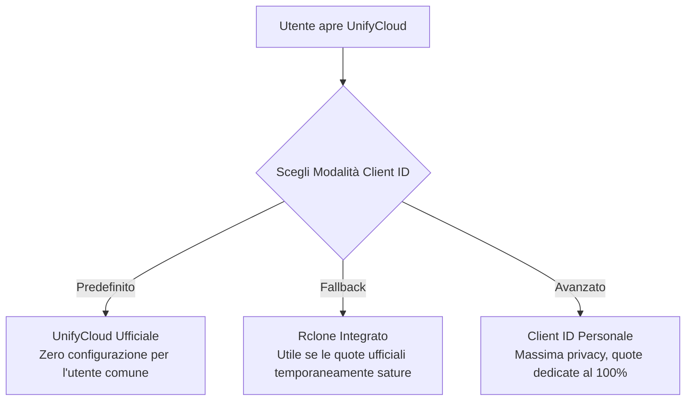

# Guida alla Creazione di Client ID OAuth2 Personali 🔑
*(Per Sviluppatori e Utenti Finali di UnifyCloud)*

Questa guida spiega passo-passo come creare e registrare i propri **Client ID** e **Client Secret** direttamente nelle console sviluppatore di **Google Cloud**, **Microsoft Azure (Entra ID)** e **Dropbox**.

---

## 🎯 Perché Usare un Client ID Personale?

Quando utilizzi un'applicazione multi-cloud:
1. **Quote e Velocità Dedicate (No Throttling)**: I provider cloud limitano il numero di richieste API al secondo (es. 1.000 req/min su Google Drive). Usando un Client ID condiviso con migliaia di utenti, rischi di incorrere in errori `429 Too Many Requests` o rallentamenti forzati. Con un proprio ID hai il 100% della banda e delle quote riservate al tuo account.
2. **Indipendenza da Rclone e Terze Parti**: Non dipendi dallo stato di approvazione o da eventuali revoche/blocchi delle chiavi pubbliche di Rclone.
3. **Nessun Blocco Aziendale / Universitario**: Molte organizzazioni bloccano esplicitamente il Client ID generico di Rclone nei tenant Microsoft Entra o Google Workspace. Creando la tua app dedicata, puoi autorizzarla senza restrizioni.
4. **Privacy Totale**: Il consenso OAuth viene stipulato direttamente ed esclusivamente tra il tuo account e la tua app personale.

---

## 🏛️ Il Modello di Autenticazione a 3 Livelli in UnifyCloud

UnifyCloud offre 3 modalità flessibili selezionabili nella finestra di connessione:

1. **UnifyCloud (Ufficiale / Consigliato)**: Utilizza le credenziali predefinite verificate dell'applicazione UnifyCloud.
2. **Rclone (Fallback / Sconsigliato)**: Utilizza le chiavi pubbliche storiche di Rclone (comodo per test rapidi, ma soggetto a limiti di quota condivisa).
3. **Client ID Personale (Avanzato)**: Permette di incollare il proprio Client ID e Client Secret creati seguendo questa guida, garantendo isolamento totale.

---

## 1. 📁 Google Drive (Google Cloud Console)

### Requisiti
- Un account Google personale o Google Workspace.

### Procedura Passo-Passo

1. **Accedi alla Google Cloud Console**:
   - Vai su [https://console.cloud.google.com/](https://console.cloud.google.com/) ed effettua il login.
2. **Crea un Nuovo Progetto**:
   - Clicca sul selettore dei progetti in alto a sinistra ➔ **Nuovo Progetto**.
   - Assegna un nome (es. `UnifyCloud Personale`) e clicca su **Crea**.
3. **Abilita la Google Drive API**:
   - Nel menu di navigazione a sinistra, vai su **API e servizi** ➔ **Libreria**.
   - Cerca **Google Drive API**, cliccaci sopra e premi **Abilita**.
4. **Configura la Schermata di Consenso OAuth**:
   - Vai su **API e servizi** ➔ **Schermata consenso OAuth**.
   - Seleziona **Esterno** (User Type) e premi **Crea**.
   - Compila i campi obbligatori:
     - *Nome applicazione*: `UnifyCloud Personale`
     - *Indirizzo email di supporto*: la tua email
     - *Dati di contatto dello sviluppatore*: la tua email
   - Clicca su **Salva e continua**.
   - Nella scheda **Ambiti (Scopes)**:
     - Clicca su **Aggiungi o rimuovi ambiti**.
     - Cerca e seleziona `https://www.googleapis.com/auth/drive` (accesso completo per sincronizzazione file).
     - Premi **Aggiorna** e poi **Salva e continua**.
   - Nella scheda **Utenti di test**:
     - Clicca su **Aggiungi utenti** e inserisci il tuo indirizzo Gmail (e quello di chi utilizzerà questo Client ID).
     - Clicca **Salva e continua**.
5. **Crea le Credenziali OAuth**:
   - Vai su **API e servizi** ➔ **Credenziali**.
   - Clicca in alto su **+ Crea credenziali** ➔ **ID client OAuth**.
   - Seleziona come *Tipo di applicazione*: **Applicazione desktop**.
   - Inserisci un nome (es. `UnifyCloud Desktop Client`).
   - Clicca su **Crea**.
6. **Ottieni Client ID e Secret**:
   - Ti apparirà una finestra con:
     - **ID client** (termina con `.apps.googleusercontent.com`)
     - **Secret client**
   - Copia entrambi i valori.
7. **Uso in UnifyCloud**:
   - In UnifyCloud seleziona **Google Drive** ➔ Modalità **Client ID Personale**.
   - Incolla il Client ID e il Client Secret e premi **Avvia Accesso nel Browser**.

> [!TIP]
> Google mostrerà una schermata con scritto *"Google non ha verificato questa app"*. È normale per progetti personali: clicca su **Avanzate** (in basso a sinistra) e poi su **Apri UnifyCloud (non sicura)** per procedere.

---

## 2. 🏢 Microsoft OneDrive (Azure Portal / Microsoft Entra ID)

### Requisiti
- Un account Microsoft personale (@outlook.com, @hotmail.com) o aziendale/universitario (Microsoft 365).

### Procedura Passo-Passo

1. **Accedi ad Azure Portal**:
   - Vai su [https://portal.azure.com/](https://portal.azure.com/) ed esegui l'accesso.
2. **Apri Microsoft Entra ID (Registrazioni app)**:
   - Nella barra di ricerca in alto scrivi **Registrazioni app** (App registrations) e selezionalo.
   - Clicca su **+ Nuova registrazione** (+ New registration).
3. **Compila i Dettagli dell'App**:
   - *Nome*: `UnifyCloud Personale`
   - *Tipi di account supportati*: seleziona la terza opzione:
     > **Account in qualsiasi directory dell'organizzazione (qualsiasi tenant di Microsoft Entra ID - Multi-tenant) e account Microsoft personali (ad esempio Skype, Xbox)**
     *(Questo permette di usare sia account aziendali sia account personali consumer).*
   - *URI di reindirizzamento (Redirect URI)*:
     - Seleziona piattaforma: **Web** oppure **Dispositivi mobili e applicazioni desktop**.
     - Inserisci l'URI:
       ```
       http://localhost:53682/
       ```
   - Clicca su **Registra** (Register).
4. **Copia l'ID Applicazione (Client ID)**:
   - Nella pagina di riepilogo dell'app creata, copia il valore:
     - **ID applicazione (client)** (è un codice GUID, es. `xxxxxxxx-xxxx-xxxx-xxxx-xxxxxxxxxxxx`).
5. **Genera un Segreto Client (Client Secret)**:
   - Nel menu a sinistra clicca su **Certificati e segreti** (Certificates & secrets).
   - Nella scheda *Segreti client*, clicca su **+ Nuovo segreto client**.
   - Inserisci una descrizione (es. `UnifyCloud Secret`) e imposta la scadenza (es. 24 mesi).
   - Clicca **Aggiungi**.
   - **IMPORTANTE**: copia subito il campo **Valore** (Value), NON l'ID segreto. Una volta ricaricata la pagina il valore verrà oscurato.
6. **Configura i Permessi API**:
   - Nel menu a sinistra clicca su **Autorizzazioni API** (API permissions).
   - Clicca su **+ Aggiungi un'autorizzazione** ➔ **Microsoft Graph** ➔ **Autorizzazioni delegate**.
   - Cerca e spunta:
     - `Files.Read`
     - `Files.ReadWrite`
     - `Files.Read.All`
     - `Files.ReadWrite.All`
     - `offline_access`
   - Clicca su **Aggiungi autorizzazioni**.
7. **Uso in UnifyCloud**:
   - In UnifyCloud seleziona **Microsoft OneDrive** ➔ Modalità **Client ID Personale**.
   - Inserisci il Client ID e il Valore del Client Secret e premi **Avvia Accesso nel Browser**.

---

## 3. 📦 Dropbox (Dropbox Developer Console)

### Procedura Passo-Passo

1. **Accedi alla Console Sviluppatori**:
   - Vai su [https://www.dropbox.com/developers/apps](https://www.dropbox.com/developers/apps) e accedi con il tuo account.
2. **Crea una Nuova Applicazione**:
   - Clicca sul pulsante **Create app** in alto a destra.
   - Seleziona:
     - *Choose an API*: **Scoped access**
     - *Choose the type of access you need*: **Full Dropbox** (accesso a tutti i file) oppure **App folder** (cartella isolata dedicata).
     - *Name your app*: es. `unifycloud-tuonome` (i nomi Dropbox devono essere univoci a livello globale).
   - Clicca su **Create app**.
3. **Configura i Permessi (Permissions)**:
   - Vai nella scheda **Permissions** in alto.
   - Spunta le seguenti autorizzazioni:
     - `files.metadata.write`
     - `files.metadata.read`
     - `files.content.write`
     - `files.content.read`
   - Clicca su **Submit** in fondo alla pagina per salvare le autorizzazioni.
4. **Configura il Redirect URI**:
   - Torna nella scheda **Settings**.
   - Sotto la sezione **OAuth 2**, cerca la voce **Redirect URIs**.
   - Inserisci:
     ```
     http://localhost:53682/
     ```
   - Clicca sul pulsante **Add**.
5. **Copia App Key e App Secret**:
   - Sempre nella scheda **Settings**, trovi:
     - **App key** (corrisponde al tuo Client ID).
     - **App secret** (clicca su *Show* per vederlo).
6. **Uso in UnifyCloud**:
   - In UnifyCloud seleziona **Dropbox** ➔ Modalità **Client ID Personale**.
   - Inserisci l'App Key e l'App Secret e avvia l'accesso.

---

## 🚀 Guida per lo Sviluppatore: Rilasciare l'App con i Propri Client ID Ufficiali

Se sei il maintainer/autore di UnifyCloud e vuoi rilasciare l'applicazione al pubblico con credenziali ufficiali integrate, segui queste indicazioni.

### È Possibile Rilasciare l'App con i Propri Client ID?
**SÌ, assolutamente.** È la prassi comune seguita da tutte le applicazioni commerciali e open-source (es. Cyberduck, Mountain Duck, Nextcloud desktop, ecc.).

### Come Funzionano le 3 Opzioni nel Rilascio:


### Best Practice di Sicurezza per il Rilascio:
1. **Google OAuth Verification**:
   - Se pubblichi un Client ID Google al grande pubblico, devi completare il processo di **Verifica dell'App** su Google Cloud Console (fornire un link alla privacy policy, un dominio o repository GitHub, e specificare che i file vengono scambiati localmente sul dispositivo dell'utente senza server intermediari). Fintanto che l'app non è verificata, Google limiterà a 100 gli utenti di test.
2. **Microsoft Entra ID**:
   - Le app registrate come multi-tenant + account personali non richiedono processi di verifica complessi per uso comune desktop.
3. **Dove inserire i Client ID Ufficiali nel Codice**:
   - Le chiavi possono essere definite in `OAuthService`:
     ```dart
     static const String unifycloudDriveClientId = '...';
     static const String unifycloudOneDriveClientId = '...';
     static const String unifycloudDropboxClientId = '...';
     ```
   - In alternativa, per repository open-source pubblici su GitHub, puoi iniettarle a tempo di compilazione usando `--dart-define`:
     ```bash
     flutter build apk --release \
       --dart-define=UC_DRIVE_CLIENT_ID="il_tuo_id" \
       --dart-define=UC_ONEDRIVE_CLIENT_ID="il_tuo_id"
     ```

