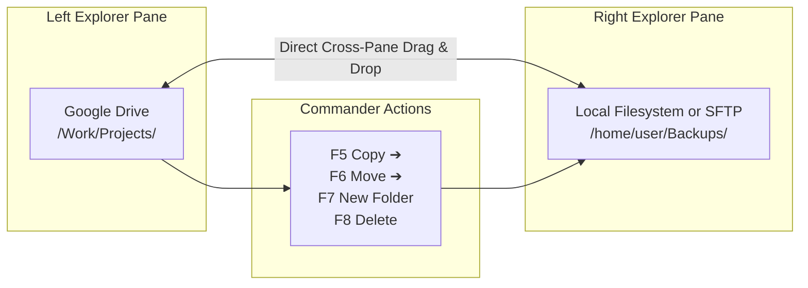

# File Management & Transfers 📁⚡

UnifyCloud offers a versatile file explorer capable of browsing local storage, remote clouds, and encrypted vaults with equal ease.

---

## 🧭 File Explorer Overview

When you tap any connected cloud or drive card on the **Home** screen, UnifyCloud launches the **File Explorer**:

```
+-------------------------------------------------------------------------+
| [<- Home]   MyGoogleDrive > Work > 2026_Reports            [Search] [::] |
+-------------------------------------------------------------------------+
| [ ] Name                     Size        Modified          Actions      |
|-------------------------------------------------------------------------|
| [D] Financial_Audit          --          01/10/2026        [...]        |
| [F] Q3_Summary.pdf           4.2 MB      30/09/2026        [...]        |
| [F] Dataset_Raw.parquet      128.5 MB    28/09/2026        [...]        |
| [F] Presentation.key         18.1 MB     25/09/2026        [...]        |
+-------------------------------------------------------------------------+
| [BOTTOM BAR: 1 file in clipboard: Q3_Summary.pdf]   [PASTE HERE]        |
+-------------------------------------------------------------------------+
```

### Key Navigation Tools:
- **Interactive Breadcrumbs Bar**: Each folder segment in the breadcrumbs bar (`Home > Work > 2026_Reports`) is clickable, allowing you to instantly jump back to any parent folder.
- **Display Modes**: Toggle between **List View** (with detailed columns for size and date) and **Grid View** (with large file-type icons and preview cards).
- **Sorting**: Sort by **Name**, **Size**, or **Modification Date** in ascending or descending order.
- **Instant Search**: Filter items in the current directory in real time without waiting for server queries.
- **Pull-to-Refresh**: Swipe down on mobile or click the refresh button on desktop to re-fetch the directory contents from the cloud API.

---

## 🖥️ Dual-Pane Commander Mode (Desktop & Tablets)

Inspired by traditional file commanders (Midnight Commander, Total Commander), UnifyCloud features a native **Dual-Pane Mode** designed for desktop monitors, foldables, and tablets:



### Features of Commander Mode:
1. **Independent Dual Navigation**: Browse two different cloud accounts or local folders side-by-side simultaneously (e.g., Google Drive on the left, Nextcloud or Local Storage on the right).
2. **Cross-Pane Drag and Drop**: Click and drag any file or directory from the left pane and drop it onto the right pane (or vice versa) to immediately initiate a transfer.
3. **Commander Action Bar**: Quick action buttons along the bottom for rapid keyboard-friendly operations:
   - **F5 / Copia (Copy)**: Copies selected items to the opposing pane.
   - **F6 / Sposta (Move)**: Moves selected items to the opposing pane.
   - **F7 / Nuova Cartella (New Folder)**: Creates a new directory in the active pane.
   - **F8 / Elimina (Delete)**: Deletes selected items with confirmation.
4. **Enabling/Disabling**: You can toggle Dual-Pane Commander Mode on or off in **Settings** ➔ **Display & Interface**.

---

## ⚡ Direct Cloud-to-Cloud Transfers

Traditional multi-cloud workflows require downloading a file from Cloud A to your local disk, waiting for it to finish, and then uploading it from your local disk to Cloud B.

**UnifyCloud eliminates the local disk bottleneck completely**:
- The embedded Go engine opens concurrent HTTP streaming pipes between the source provider and destination provider.
- Data streams directly from Cloud A into Cloud B in memory chunks.
- Your local hard drive is never burdened with temporary cache files.

### How to Copy or Move Files Across Clouds:
1. Navigate to the source cloud (e.g., `GoogleDrive`).
2. Click the **3-dots menu** `[...]` next to any file or directory.
3. Select **Copia (Copy)** or **Taglia (Cut / Move)**.
4. A floating clipboard banner appears at the bottom: *"File ready for transfer: Presentation.pdf"*.
5. Navigate to any other destination folder on a different remote (e.g., `Dropbox`, `ServerSFTP`, or `LocalDrive`).
6. Click **Incolla qui (Paste here)** on the clipboard bar.
7. The transfer job starts immediately in the background!

---

## 📈 Transfer Manager & Real-Time Statistics

UnifyCloud provides real-time visibility into all file operations:

```
+-------------------------------------------------------------+
|  Active Transfers (2)               4.8 MB/s   ETA: 00:01:24 |
+-------------------------------------------------------------+
|  Uploading: Video_Raw.mp4                                   |
|  [=======================>           ] 68% (1.4 GB / 2.1 GB)|
|  Speed: 4.8 MB/s - Destination: MyNextcloud:Media           |
|  [ Cancel Job ]                                             |
+-------------------------------------------------------------+
```

### Monitoring Active Jobs:
- **Floating Transfer Pill**: When transfers are running, a compact floating widget displays real-time combined speed (`MB/s`) and percentage.
- **Transfer Manager Bottom Sheet**: Tap the pill to expand the complete transfer dashboard:
  - **In Progress**: Active jobs with speed counters, transferred bytes, and dynamic ETA calculation.
  - **Queued**: Pending jobs waiting for a free worker slot based on your *Max Concurrent Transfers* setting.
  - **Completed**: Finished transfers with execution timestamps.
  - **Failed**: Jobs that encountered an error (e.g., remote quota exceeded, network drop). Tapping the job displays the full expandable error log.
- **Job Cancellation**: Tap the red **Cancel** icon on any active job to gracefully abort the transfer immediately.
- **Clear Completed**: Remove finished jobs from the history list with a single click.

---

## 🔗 Public Share Links & Local Actions

### Creating Public Share Links:
For supported cloud backends (Google Drive, Dropbox, Nextcloud):
1. Tap the **3-dots menu** `[...]` on a file.
2. Select **Condividi / Crea Link (Share / Create Link)**.
3. UnifyCloud calls the native backend API to generate a public, read-only URL.
4. Tap **Copia Link (Copy Link)** to paste it into an email or messaging app.

### Downloading Files to Local Disk:
1. Tap the **3-dots menu** `[...]` on any remote file.
2. Select **Scarica (Download)**.
3. The file is saved to your default system Downloads directory (or the custom path configured in UnifyCloud Settings).

### Opening Files with Native System Apps:
1. Tap directly on any file (or select **Apri (Open)** from the menu).
2. UnifyCloud will stream or download the file and invoke the operating system's registered application (e.g., PDF viewer, media player, image editor) through standard OS portals.
