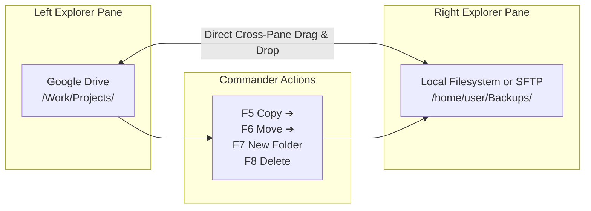

# File Management & Transfers 📁⚡

UnifyCloud offers a versatile file explorer capable of browsing local storage, remote clouds, and encrypted vaults with equal ease.

---

## 🧭 File Explorer Overview

When you tap any connected cloud or drive card on the **Home** screen, UnifyCloud launches the **File Explorer**:

```
+-------------------------------------------------------------------------+
| [<- Home]   MyGoogleDrive > Work > 2026_Reports            [Search] [::] |
+-------------------------------------------------------------------------+
| [ ] Name                     Size        Modified          Actions      |
|-------------------------------------------------------------------------|
| [D] Financial_Audit          --          01/10/2026        [...]        |
| [F] Q3_Summary.pdf           4.2 MB      30/09/2026        [...]        |
| [F] Dataset_Raw.parquet      128.5 MB    28/09/2026        [...]        |
| [F] Presentation.key         18.1 MB     25/09/2026        [...]        |
+-------------------------------------------------------------------------+
| [BOTTOM BAR: 1 file in clipboard: Q3_Summary.pdf]   [PASTE HERE]        |
+-------------------------------------------------------------------------+
```

### Key Navigation & Toolbar Tools:
- **Disk Chooser Dropdown**: Switch between any connected cloud or local remote directly from the Explorer AppBar. Crypt vaults display an **`AES-256`** badge to indicate active end-to-end encryption.
- **Interactive Breadcrumbs Bar**: Each folder segment in the breadcrumbs bar (`Home > Work > 2026_Reports`) is clickable, allowing you to instantly jump back to any parent folder.
- **Compact Adaptive Toolbar**: On narrower screens or dual-pane windows, secondary toolbar controls automatically collapse into a clean overflow menu (`...`) while keeping **Search** and **Upload** one tap away.
- **Display Modes**: Toggle between **List View** (with detailed columns for size and date) and **Grid View** (with large file-type icons and preview cards).
- **Sorting**: Sort by **Name**, **Size**, or **Modification Date** in ascending or descending order.
- **Instant Search**: Filter items in the current directory in real time without waiting for server queries.
- **Pull-to-Refresh**: Swipe down on mobile or refresh the directory to re-fetch contents from the cloud API.
- **Protected Back Navigation**: Pressing the system/Android **Back** button inside the Explorer progressively closes multi-selection mode, exits search mode, or navigates up to the parent folder instead of accidentally exiting the application.
- **Explorer Preferences**: Under **Settings ➔ Files & Exploration**, you can toggle **Show hidden files**, **Confirm before deleting**, **Dual-Pane Mode**, your **Default download folder**, and **Long press action**.

---

## 📌 Pinned Favorites (Home Screen Quick Access)

Pin important files and folders to the **Pinned** card on your **Home** screen so you can reach them immediately without navigating deep folder trees:

- **Pin / Unpin**: Open the **3-dots menu** (or right-click context menu) on any file or folder in the Explorer and select **Pin to Home** / **Unpin from Home**.
- **One-Tap Access**:
  - **Tap a pinned folder** on the Home screen to open it directly in the File Explorer.
  - **Tap a pinned file** to download/stream and open it with your device's default system app.
  - **Long-press a pinned file** to jump straight to its containing parent folder in the File Explorer.
- **Automatic Cleanup**: Unpin any entry with the **`×`** button on the Home card. Disconnecting a remote automatically cleans up its pinned favorites.

---

## ⬆️ Unified Upload (Files & Folders)

Tapping the **Upload** button in the Explorer toolbar opens a unified upload dialog offering two modes:

1. **Upload File(s)**: Opens the system file picker with multi-file selection and queues all chosen files into the current remote directory.
2. **Upload Folder**: Opens the system directory picker and recursively scans and uploads the entire folder while preserving its nested directory structure on the cloud.

---

## ✅ Multi-Selection & Batch Operations

Manage multiple files and folders at once:

1. Tap the **Multi-selection** checklist button in the Explorer toolbar (or long-press an item when Long Press Action is set to **Select**).
2. Tap items to select/deselect them, or use **Select All / Deselect All** in the selection AppBar.
3. Execute batch actions across all selected items:
   - **Download selected** (downloads selected files to your configured download folder)
   - **Copy / Cut to clipboard** (queues selected items in the multi-cloud clipboard)
   - **Copy / Move to opposite pane** (when Dual-Pane Commander Mode is active)
   - **Delete selected** (with optional confirmation prompt)

---

## 👆 Customizable Long-Press & Drag-and-Drop

In **Settings ➔ Files & Exploration ➔ Long press action**, you can customize what long-pressing an item in the Explorer does on touch/mobile devices:

| Long-Press Mode | Behavior |
|---|---|
| **Select** *(Default)* | Toggles multi-selection for the item. |
| **Move (Drag)** | Lets you drag the item directly into a subfolder or across to the opposite pane in Dual-Pane Mode. |
| **Actions menu** | Opens the item's context menu (open, download, pin, share, rename, delete, info). |
| **Cut** | Cuts the item straight to the multi-cloud clipboard so you can paste-move it elsewhere. |

> [!TIP]
> On desktop with a mouse/trackpad, pointer drag-and-drop works seamlessly into subfolders and across panes regardless of the touch long-press setting.

---

## 🖥️ Dual-Pane Commander Mode (Desktop & Tablets)

Inspired by traditional file commanders (Midnight Commander, Total Commander), UnifyCloud features a native **Dual-Pane Mode** designed for desktop monitors, foldables, and tablets (automatically enabled on screens `>= 900px` wide when toggled on):



### Features of Commander Mode:
1. **Independent Dual Navigation**: Browse two different cloud accounts or local folders side-by-side simultaneously (e.g., Google Drive on the left, Nextcloud or Local Storage on the right).
2. **Cross-Pane & Folder Drag-and-Drop**: Drag any file or directory from one pane onto the opposing pane—or directly onto a folder tile—to immediately copy or move it.
3. **Commander Action Bar**: Quick action buttons along the bottom for rapid operations:
   - **F5 / Copy**: Copies selected items to the opposing pane.
   - **F6 / Move**: Moves selected items to the opposing pane.
   - **F7 / New Folder**: Creates a new directory in the active pane.
   - **F8 / Delete**: Deletes selected items with confirmation.
4. **Enabling/Disabling**: Toggle Dual-Pane Commander Mode via the toolbar button on wide screens or in **Settings ➔ Files & Exploration**.

---

## ⚡ Direct Cloud-to-Cloud Transfers

Traditional multi-cloud workflows require downloading a file from Cloud A to your local disk, waiting for it to finish, and then uploading it from your local disk to Cloud B.

**UnifyCloud eliminates the local disk bottleneck completely**:
- The embedded Go engine opens concurrent HTTP streaming pipes between the source provider and destination provider.
- Data streams directly from Cloud A into Cloud B in memory chunks.
- Your local hard drive is never burdened with temporary cache files.

### How to Copy or Move Files Across Clouds:
1. Navigate to the source cloud (e.g., `GoogleDrive`).
2. Click the **3-dots menu** `[...]` (or right-click) on any file or directory, or select multiple items in multi-selection mode.
3. Select **Copy** or **Cut**.
4. A floating clipboard banner appears: *"Copy: Presentation.pdf (from GoogleDrive)"*.
5. Navigate to any other destination folder on a different remote (e.g., `Dropbox`, `ServerSFTP`, or `LocalDisk`).
6. Click **Paste here** on the clipboard bar.
7. The transfer job starts immediately in the background!

---

## 📈 Transfer Manager & Real-Time Statistics

UnifyCloud provides real-time visibility into all file operations:

```
+-------------------------------------------------------------+
|  Active Transfers (2)               4.8 MB/s   ETA: 00:01:24 |
+-------------------------------------------------------------+
|  Uploading: Video_Raw.mp4                                   |
|  [=======================>           ] 68% (1.4 GB / 2.1 GB)|
|  Speed: 4.8 MB/s - Destination: MyNextcloud:Media           |
|  [ Cancel Job ]                                             |
+-------------------------------------------------------------+
```

### Monitoring Active Jobs:
- **Floating Transfer Pill**: When transfers are running, a compact floating widget displays real-time combined speed (`MB/s`) and percentage. On desktop, active transfer counts and speeds also appear in the **System Tray** tooltip and menu.
- **Transfer Manager Bottom Sheet**: Tap the pill to expand the complete transfer dashboard:
  - **In Progress**: Active jobs with speed counters, transferred bytes, and dynamic ETA calculation.
  - **Queued**: Pending jobs waiting for a free worker slot based on your *Max Concurrent Transfers* setting.
  - **Completed**: Finished transfers with execution timestamps.
  - **Failed**: Jobs that encountered an error (e.g., remote quota exceeded, network drop). Tapping the job displays the full expandable error log.
- **Job Cancellation & Retry**: Tap **Cancel** on any active job to gracefully abort it immediately, or retry failed transfers.
- **Clear Completed**: Remove finished jobs from the history list with a single click.

---

## 🔗 Public Share Links & Local Actions

### Creating Public Share Links:
For supported cloud backends (Google Drive, Dropbox, Nextcloud):
1. Tap the **3-dots menu** `[...]` (or right-click) on a file.
2. Select **Create Share Link**.
3. UnifyCloud calls the native backend API to generate a public, read-only URL.
4. Tap **Copy Link** to paste it into an email or messaging app.

### Downloading Files to Local Disk:
1. Tap the **3-dots menu** `[...]` on any remote file (or use multi-selection for batch downloads).
2. Select **Download**.
3. The file is saved to your default system Downloads directory (or the custom path configured in **Settings ➔ Files & Exploration ➔ Default download folder**).

### Opening Files with Native System Apps:
1. Tap directly on any file (or select **Open with system app** from the menu).
2. UnifyCloud downloads the file and invokes the operating system's registered application (e.g., PDF viewer, media player, image editor) through standard OS portals.
