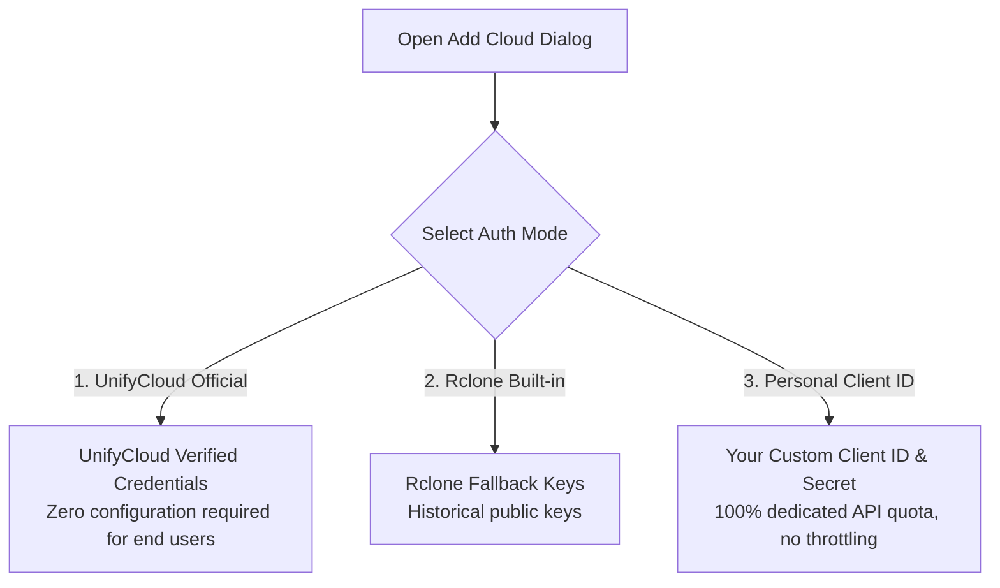

# OAuth 2.0 Client ID & Secret Setup Guide 🔑

*(For End Users and Developers of UnifyCloud)*

This guide provides step-by-step instructions on creating, registering, and configuring your own custom **OAuth2 Client ID** and **Client Secret** directly in the developer consoles of **Google Cloud**, **Microsoft Azure (Entra ID)**, and **Dropbox**.

---

## 🎯 Why Use a Personal Client ID & Secret?

When connecting to public cloud services:

1. **Dedicated Bandwidth & Dedicated API Quotas (No Throttling)**:
   Cloud providers enforce strict per-application API rate limits. For example, Google Drive imposes a default cap of 1,000 requests per 100 seconds per project. If thousands of users share a single generic public client ID, you may encounter `429 Too Many Requests` errors or temporary transfer stalls. Using your own Client ID gives your account **100% of the allocated API quota**.
2. **Immunity from Third-Party Revocation**:
   You do not rely on the status, public quotas, or maintenance cycles of external keys.
3. **Bypass Corporate & University Restrictions**:
   Many organizations and universities explicitly block generic third-party OAuth IDs (like Rclone's historical keys) in their Microsoft Entra or Google Workspace security policies. Registering your own application ID allows you to approve and use your account seamlessly.
4. **Total Privacy**:
   The OAuth consent agreement is established directly and exclusively between your personal account and your private developer console project.

---

## 🏛️ The 3-Tier Authentication Model in UnifyCloud

When adding an OAuth-based cloud remote in UnifyCloud, you can select between 3 modes:



1. **UnifyCloud (Official / Recommended)**: Built-in production credentials configured for the app.
2. **Rclone (Fallback)**: Historical default keys provided as a backup.
3. **Personal Client ID (Advanced)**: Allows you to paste the Client ID and Secret you create by following this guide.

---

## 1. 📁 Google Drive Setup (Google Cloud Console)

### Prerequisites
- A Google account (Personal `@gmail.com` or Google Workspace).

---

### Step-by-Step Instructions

#### Step 1: Open Google Cloud Console
1. Navigate to [https://console.cloud.google.com/](https://console.cloud.google.com/) and log in with your Google account.

#### Step 2: Create a New Project
1. Click the **Project Selector** dropdown in the top navigation bar.
2. Click **New Project** in the upper-right corner of the modal.
3. Enter a project name (e.g., `UnifyCloud Personal`) and click **Create**.
4. Make sure your newly created project is selected in the top bar.

#### Step 3: Enable the Google Drive API
1. In the left navigation menu, go to **APIs & Services** ➔ **Library**.
2. In the search box, type `Google Drive API`.
3. Click on the **Google Drive API** result and click the blue **Enable** button.

#### Step 4: Configure the OAuth Consent Screen
1. In the left menu, select **APIs & Services** ➔ **OAuth consent screen**.
2. Select **External** as the *User Type* and click **Create**.
3. Fill in the required application fields:
   - **App name**: `UnifyCloud Personal`
   - **User support email**: Select your email address.
   - **Developer contact information**: Enter your email address.
4. Click **Save and Continue**.
5. **Scopes Configuration**:
   - Click **Add or Remove Scopes**.
   - In the filter box, search for `drive`.
   - Select the scope: `https://www.googleapis.com/auth/drive` *(See, edit, create, and delete all of your Google Drive files)*.
   - Click **Update** at the bottom, then click **Save and Continue**.
6. **Test Users Configuration**:
   - While the app is in "Testing" mode, Google requires you to explicitly whitelist accounts allowed to log in.
   - Click **+ Add Users**.
   - Enter your Gmail address (and any family/friends' accounts who will use this project).
   - Click **Save and Continue**.
7. Click **Back to Dashboard**.

#### Step 5: Create the Desktop OAuth Client ID
1. In the left menu, click **APIs & Services** ➔ **Credentials**.
2. At the top of the page, click **+ Create Credentials** ➔ **OAuth client ID**.
3. In the *Application type* dropdown, select **Desktop app**.
4. In the *Name* field, enter `UnifyCloud Desktop Client`.
5. Click **Create**.

#### Step 6: Retrieve Your Keys
A modal will display:
- **Client ID** (a long string ending with `.apps.googleusercontent.com`)
- **Client Secret**
Copy both values to your clipboard or a safe text file.

#### Step 7: Connect in UnifyCloud
1. In UnifyCloud, click **+ Add Cloud** ➔ **Google Drive**.
2. Set Auth Mode to **Client ID Personale (Custom)**.
3. Paste your **Client ID** and **Client Secret**.
4. Click **Avvia Accesso nel Browser (Launch Browser Sign-In)**.
5. In the opened browser window:
   - Google will show a screen stating: *"Google hasn't verified this app"*.
   - Click **Advanced** (in the bottom left).
   - Click **Go to UnifyCloud Personal (unsafe)**.
   - Click **Continue** to grant file permissions.
6. The browser will redirect to `http://127.0.0.1:53682/` with a success notice. Return to UnifyCloud and click **Save & Connect**.

---

## 2. 🏢 Microsoft OneDrive Setup (Azure Portal / Entra ID)

### Prerequisites
- A Microsoft account (Personal `@outlook.com`, `@hotmail.com` or an organization / university account).

---

### Step-by-Step Instructions

#### Step 1: Open Azure Portal App Registrations
1. Navigate to [https://portal.azure.com/](https://portal.azure.com/) and sign in.
2. In the top search bar, type `App registrations` (or *Registrazioni app*) and select it.
3. Click **+ New registration** in the top toolbar.

#### Step 2: Register the Application
1. **Name**: Enter `UnifyCloud Personal`.
2. **Supported account types**: Select the **third option**:
   > **Accounts in any organizational directory (Any Microsoft Entra ID tenant - Multitenant) and personal Microsoft accounts (e.g. Skype, Xbox)**
   *(This ensures you can log into both work/school Microsoft 365 accounts and personal Outlook accounts).*
3. **Redirect URI (optional)**:
   - Select platform: **Web** (or **Mobile and desktop applications**).
   - Enter the URI:
     ```
     http://localhost:53682/
     ```
4. Click **Register**.

#### Step 3: Copy the Application (Client) ID
On the app's **Overview** page, copy the:
- **Application (client) ID** (a GUID format such as `xxxxxxxx-xxxx-xxxx-xxxx-xxxxxxxxxxxx`).

#### Step 4: Create a Client Secret
1. In the left navigation menu, click **Certificates & secrets**.
2. Under the **Client secrets** tab, click **+ New client secret**.
3. Add a description (e.g., `UnifyCloud App Secret`) and choose an expiration (e.g., 24 months).
4. Click **Add**.
5. **CRITICAL**: Immediately copy the **Value** column (NOT the Secret ID). The value is masked permanently once you navigate away from this page.

#### Step 5: Configure Microsoft Graph API Permissions
1. In the left navigation menu, click **API permissions**.
2. Click **+ Add a permission** ➔ **Microsoft Graph** ➔ **Delegated permissions**.
3. Search and check the following permissions:
   - `Files.Read`
   - `Files.ReadWrite`
   - `Files.Read.All`
   - `Files.ReadWrite.All`
   - `offline_access` *(Required for long-term token refresh without re-login)*
4. Click **Add permissions**.

#### Step 6: Connect in UnifyCloud
1. In UnifyCloud, choose **Microsoft OneDrive** ➔ **Client ID Personale**.
2. Paste the **Application (Client) ID** and the **Client Secret Value**.
3. Tap **Launch Browser Sign-In**, authorize your account, and tap **Save & Connect**. UnifyCloud will automatically query your OneDrive `drive_id` and complete the setup.

---

## 3. 📦 Dropbox Setup (Dropbox Developer Console)

### Prerequisites
- A standard personal or business Dropbox account.

---

### Step-by-Step Instructions

#### Step 1: Open the Dropbox App Console
1. Navigate to [https://www.dropbox.com/developers/apps](https://www.dropbox.com/developers/apps) and sign in.
2. Click the blue **Create app** button in the top right.

#### Step 2: Configure the App
1. **Choose an API**: Select **Scoped access**.
2. **Choose the type of access**:
   - Select **Full Dropbox** (to access all folders in your Dropbox account), or **App folder** (if you prefer restricting UnifyCloud to a dedicated sandbox folder `Apps/UnifyCloud`).
3. **Name your app**: Enter a unique name (e.g., `unifycloud-yourname-sync`). *Note: Dropbox requires globally unique application names.*
4. Click **Create app**.

#### Step 3: Configure Scoped Permissions
1. In the app settings page, click the **Permissions** tab.
2. Check the following scopes under *Files and folders*:
   - `files.metadata.write`
   - `files.metadata.read`
   - `files.content.write`
   - `files.content.read`
3. Click the blue **Submit** button at the bottom of the page to save changes.

#### Step 4: Add the Redirect URI
1. Click the **Settings** tab.
2. Scroll to the **OAuth 2** section.
3. Locate **Redirect URIs** and input:
   ```
   http://localhost:53682/
   ```
4. Click **Add**.

#### Step 5: Copy App Key and App Secret
Still in the **Settings** tab:
- **App key**: This is your Client ID.
- **App secret**: Click *Show* and copy the secret.

#### Step 6: Connect in UnifyCloud
1. In UnifyCloud, select **Dropbox** ➔ **Client ID Personale**.
2. Paste the **App Key** and **App Secret**.
3. Tap **Launch Browser Sign-In** and complete authorization.

---

## 🚀 Developer Guide: Injecting Official Keys at Build Time

If you are building custom distribution binaries or maintaining a fork of UnifyCloud, you can inject production OAuth credentials securely at compile time using Flutter's `--dart-define` flags without committing secrets to source control:

```bash
flutter build apk --release \
  --dart-define=UC_DRIVE_CLIENT_ID="your-google-client-id.apps.googleusercontent.com" \
  --dart-define=UC_DRIVE_CLIENT_SECRET="your-google-client-secret" \
  --dart-define=UC_ONEDRIVE_CLIENT_ID="your-onedrive-client-id" \
  --dart-define=UC_ONEDRIVE_CLIENT_SECRET="your-onedrive-client-secret" \
  --dart-define=UC_DROPBOX_CLIENT_ID="your-dropbox-app-key" \
  --dart-define=UC_DROPBOX_CLIENT_SECRET="your-dropbox-app-secret"
```

These values are compiled directly into the Dart application bytecode and used automatically when users select the **UnifyCloud (Official)** mode!
