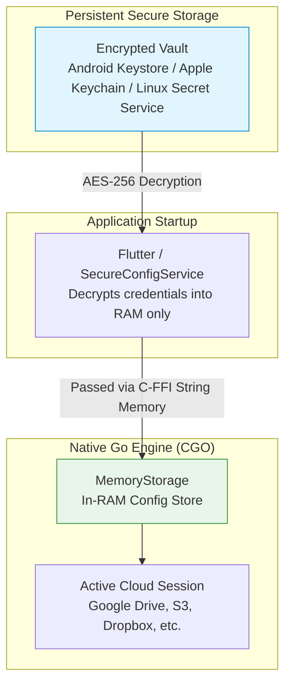

# Security, Privacy & App Lock 🛡️

Security and data privacy are the foundational design principles of UnifyCloud. This document outlines how your credentials, tokens, and files are protected across devices.

---

## 🔒 Zero-Plaintext In-RAM Architecture

Many CLI-based cloud managers or multi-cloud tools write an unencrypted configuration file (such as `rclone.conf`, `.credentials`, or plain `.json` files) directly to your home directory or app sandbox. On rooted devices or shared computers, these plaintext files can be stolen by malicious software or exposed during unencrypted backups.

**UnifyCloud utilizes a zero-plaintext in-memory storage model**:



1. **Persistent Encryption**: All cloud configurations, OAuth refresh tokens, and passwords are saved using the platform's hardware-backed cryptographic storage via `flutter_secure_storage`.
2. **Startup Token Sanitization & In-RAM Injection**: At application launch, `TokenUtils.sanitizeIniConfig()` normalizes any legacy/malformed token formatting and the decrypted configuration is transferred across the native Dart FFI boundary directly into a custom `MemoryStorage` structure in the Go engine.
3. **Zero Plaintext on Disk**: The Go engine never calls `configfile.Save()` to disk. Tokens exist only in volatile RAM while the application is running and are completely wiped when the app closes, a remote is disconnected, or you trigger **Clear All Credentials** in **Settings ➔ Security**.

---

## 🔑 Operating System Keychain Integrations

UnifyCloud integrates directly with the official security frameworks of each platform:

| Platform | Underlying Security Service | Encryption Standard |
|---|---|---|
| **Android** | Android Keystore Provider & EncryptedSharedPreferences | AES-256 GCM (Hardware-backed on supported devices) |
| **Linux** | FreeDesktop Secret Service API (`libsecret`, GNOME Keyring, KWallet) | AES-256 (Protected by user session login password) |
| **macOS** | Apple Keychain Services | AES-256 (Protected by Secure Enclave / login keychain) |
| **iOS** | iOS Keychain | Hardware-backed Secure Enclave with `kSecAttrAccessibleWhenUnlocked` |
| **Windows** | Windows Data Protection API (DPAPI) | Triple-DES / AES (Tied to user Windows credentials) |

---

## 🔐 App Lock: 6-Digit PIN & Biometrics

To protect your cloud accounts from unauthorized physical access when handing your unlocked phone or laptop to someone else, UnifyCloud includes a built-in **App Lock Gate**:

```
+-------------------------------------------------------------+
|                                                             |
|                          [ LOCK ICON ]                      |
|                                                             |
|                           UnifyCloud                        |
|                     Enter your 6-digit PIN                  |
|                                                             |
|                        [ * * * * * * ]                      |
|                                                             |
|                        [ 1 ] [ 2 ] [ 3 ]                    |
|                        [ 4 ] [ 5 ] [ 6 ]                    |
|                        [ 7 ] [ 8 ] [ 9 ]                    |
|                        [BIO] [ 0 ] [DEL]                    |
|                                                             |
|                   [ Unlock with Biometrics ]                |
|                                                             |
+-------------------------------------------------------------+
```

### Features:
- **6-Digit PIN Protection**: Set a 6-digit numeric PIN with desktop keyboard entry support and automatic submission on the 6th digit.
- **Salted PBKDF2-HMAC-SHA256 Storage**: Your PIN is never stored in plaintext. `AppLockService` derives a cryptographic hash using **PBKDF2-HMAC-SHA256** (`100,000` iterations with a random 16-byte salt) and performs constant-time verification.
- **Biometric Authentication**: Unlock effortlessly using Fingerprint, Touch ID, or Face Recognition via Android `BiometricPrompt` and Apple `LocalAuthentication`.
- **Auto-Lock Timeout**: Configure when the application re-locks after leaving the foreground:
  - **Immediately**: Locks the instant the app is minimized or switched to another app.
  - **After 1 minute**
  - **After 5 minutes**
  - **After 15 minutes**
  - **After 30 minutes**
- **App Lock Gate**: While locked, all UI routes and data are completely shielded behind a full-screen gate (`PopScope` blocks back dismissal). No drive lists, file names, or cached folders can be viewed until authentication succeeds.

### Setting Up App Lock:
1. Open **Settings** ➔ **Security & Encryption**.
2. Toggle ON **App Lock**.
3. Enter your desired 6-digit PIN, then confirm it.
4. *(Optional)* Toggle ON **Biometric Authentication** to allow fingerprint or face unlock.
5. Choose your preferred **Auto-Lock** timeout.
6. Use **Change PIN** anytime (requires verifying your current PIN first), or toggle App Lock OFF after verifying your current PIN.

---

## 🛡️ Client-Side AES-256 Crypt Vaults

When using public cloud providers (such as Google Drive, OneDrive, or Dropbox), your files may be subject to automated scanning, indexing, or third-party subpoenas.

UnifyCloud solves this by embedding Rclone's battle-tested **Crypt** backend:

### Cryptographic Standards:
- **File Content Encryption**: **AES-256-CTR** (Counter Mode) with **Poly1305** message authentication code (MAC) for authenticated data integrity.
- **Filename Encryption**:
  - `standard`: Encrypts filenames using AES-256 with base32 hex encoding. Directory names and file extensions are hidden.
  - `obfuscate`: Obfuscates names with a lightweight substitution cipher.
- **Key Derivation**: Password and salt pass through **Scrypt** key derivation to resist brute-force dictionary attacks.
- **Universal Portability**: Vaults created in UnifyCloud use standard Rclone Crypt format. You can mount or decrypt your files on any computer running official Rclone CLI:
  ```bash
  rclone mount myremote:EncryptedVault /mnt/vault --crypt-password="your-password"
  ```

> [!TIP]
> Always keep a safe offline backup of your **Crypt Master Password** and **Salt**. Without these two strings, neither UnifyCloud nor the cloud provider can decrypt your data.
