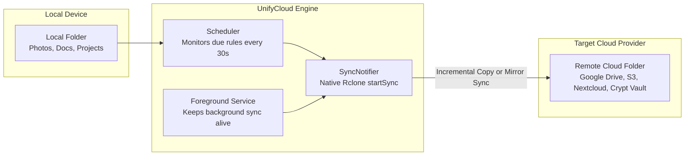

# Setting Up & Managing Synchronization 🔄

UnifyCloud includes an automated synchronization engine powered by native Rclone primitives. You can create scheduled or on-demand sync rules between local folders on your device and any connected cloud provider.

---

## 💡 Overview: How UnifyCloud Sync Works



- **In-Memory & Persistent Storage**: Your configured sync rules are encrypted and saved securely (`flutter_secure_storage`).
- **Autonomous Periodic Scheduler**: A non-blocking background timer checks every 30 seconds for rules that have become due based on their scheduled frequency and last run timestamp.
- **Background Protection**: On Android, UnifyCloud utilizes an Android Foreground Service so sync jobs continue executing even when the app is minimized or the screen is turned off.

---

## ⚖️ Understanding Sync Modes: Backup vs. Mirror

When setting up a rule, choosing the correct **Sync Mode** is critical to avoid accidental file loss:

| Sync Mode | Engine Command | Behavior | When to Use |
|---|---|---|---|
| **Incremental Backup** | `copy` | Copies all new and modified files from your local folder to the cloud. **Files deleted locally are NEVER deleted on the cloud.** | **Recommended for personal backups:** Camera roll photos, phone documents, receipts, family archives, safeguard against ransomware. |
| **Mirror Synchronization** | `sync` | Makes the destination cloud folder an **exact 1:1 duplicate** of your local folder. **Files deleted locally WILL BE DELETED from the cloud.** | **Recommended for active work:** Coding repositories, shared team workspaces, synced working folders where you want remote purges to reflect local cleanups. |

> [!WARNING]
> **Mirror Synchronization (`sync`) will delete remote files** that do not exist in your local source folder. If you want to keep historical files on the cloud even after deleting them from your local device to free up storage space, **always select Incremental Backup (`copy`)**.

---

## ⏱️ Schedule Frequencies & Background Execution

UnifyCloud offers 7 frequency tiers for every rule:

| Frequency | Execution Interval | Typical Use Case |
|---|---|---|
| **Manual (On Demand)** | Only executes when you tap **"Sync Now"** | Battery-conservative backups, large media folders, metered cellular connections. |
| **Every 15 minutes** | `15 minutes` | High-priority active working folders. |
| **Every 30 minutes** | `30 minutes` | Standard day-to-day document workflows. |
| **Every hour** | `1 hour` | Balanced frequency for documents and notes. |
| **Every 6 hours** | `6 hours` | Periodic daytime snapshots. |
| **Every 12 hours** | `12 hours` | Twice-daily backups (morning & evening). |
| **Daily (Every 24 hours)** | `24 hours` | Photo backups and comprehensive system archival. |

---

## 🚀 How to Create a Sync Rule (Step-by-Step)

### Step 1: Open the Sync Rules Screen
- On **Desktop / Tablet**: Click **Regole di Sincronizzazione (Sync Rules)** in the left navigation sidebar.
- On **Mobile**: Tap the **Sync** tab in the bottom navigation bar (or open it from the top navigation drawer).

### Step 2: Open the Rule Creator Dialog
- Tap the **"+ Nuova Regola (New Rule)"** button (or the `+` Floating Action Button).

### Step 3: Configure Rule Details

1. **Nome Regola (Rule Name)**:
   - Enter a descriptive label (e.g., `Camera Roll to Nextcloud`, `Work Documents to Google Drive`, `Obsidian Vault to Crypt`).
2. **Cartella Locale di Origine (Local Source Folder)**:
   - Tap **"Sfoglia cartella (Browse folder)"** to open your native OS directory picker.
   - Select the directory on your device you wish to back up (e.g., `/storage/emulated/0/DCIM/Camera` on Android, or `/home/user/Documents` on Linux).
3. **Cloud Remoto di Destinazione (Destination Remote)**:
   - Select one of your configured cloud accounts from the dropdown menu (e.g., `GoogleDrive`, `MyNextcloud`, `VaultCifrato`).
4. **Percorso Remoto (Remote Subfolder)**:
   - Specify the target folder path on the cloud (e.g. `Backups/PhoneCamera` or `Sync/Work`).
   - If the folder does not exist yet on the cloud, the engine will create it automatically.
5. **Modalità di Sincronizzazione (Sync Mode)**:
   - Select either **Backup Incrementale (copy)** or **Sincronizzazione Mirror (sync)**.
6. **Frequenza di Esecuzione (Frequency)**:
   - Choose how frequently the rule should run (from *Manuale* to *Ogni giorno*).
7. **Abilita Regola (Enable Rule)**:
   - Keep checked (ON) to activate immediate scheduling.

### Step 4: Save & Start
- Tap **Salva Regola (Save Rule)**.
- The rule card will immediately appear in your **Sync Rules** dashboard.

---

## 📊 Monitoring Status & Managing Rules

Each sync rule is presented as an interactive dashboard card:

```
+-------------------------------------------------------------+
|  Camera Roll to Nextcloud                [SWITCH: ON]   [:] |
|  Locale: /storage/emulated/0/DCIM/Camera                     |
|  Cloud:  MyNextcloud:Backups/PhoneCamera                    |
|  Modo:   Backup Incrementale    Frequenza: Ogni ora          |
|                                                             |
|  [STATUS BADGE: Completata]   Ultimo sync: 14:15 - 02/10    |
|                                                             |
|  [ Sincronizza Ora ]       [ Modifica ]       [ Elimina ]   |
+-------------------------------------------------------------+
```

### Rule Status Indicators:
- **⚪ Non eseguita (Idle)**: The rule is waiting for its scheduled interval or has not yet been triggered.
- **🔵 In corso... (In Progress)**: The background engine is actively analyzing files, comparing checksums/timestamps, and transferring modified blocks. An active job ID is assigned.
- **🟢 Completata (Completed)**: The synchronization finished successfully with zero errors. Displays the exact date and timestamp of the last successful run.
- **🔴 Errore (Failed)**: An error occurred (e.g., source folder moved, cloud token expired, network disconnected). Tapping the card displays the full expandable error message.

### Quick Actions:
- **Sincronizza Ora (Sync Now)**: Triggers immediate on-demand execution without waiting for the scheduled timer.
- **Enable / Disable Switch**: Pause an automated rule without deleting its configuration.
- **Modifica (Edit)**: Change local path, destination, frequency, or sync mode.
- **Elimina (Delete)**: Removes the sync rule. If a transfer is currently active for this rule, UnifyCloud will automatically terminate the running job gracefully before removing the configuration.

---

## 🛡️ Best Practices & Safety Tips

1. **Verify Source Paths**:
   Make sure your local source directory is permanent. If you select a folder on a removable USB drive or SD card that gets disconnected, the rule will enter `Errore` state until the drive is reconnected.
2. **Avoid Circular or Nested Rules**:
   Do not configure two conflicting sync rules that point to each other's target directories, as this can cause redundant transfer loops.
3. **Use Crypt for Sensitive Cloud Sync**:
   If syncing sensitive documents (tax records, ID scans, private keys) to public clouds like Google Drive or Dropbox, configure your sync destination pointing to an **End-to-End Encrypted Crypt Vault** (`VaultCifrato:MyDocs`). Files are automatically encrypted on your device before upload!
4. **Android Battery Optimization**:
   Ensure UnifyCloud is set to **Unrestricted** battery usage in Android settings. Android's aggressive background management can otherwise stop long-running sync jobs when your phone is asleep.
