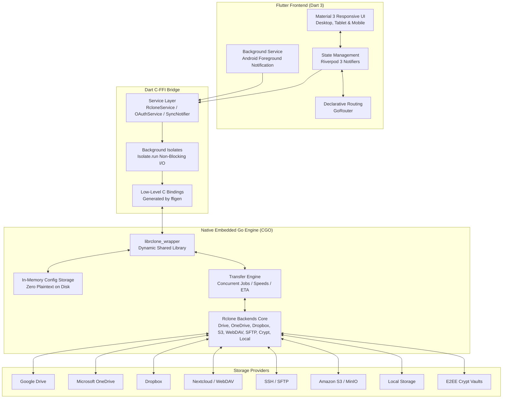

# Welcome to the UnifyCloud Wiki ☁️

**UnifyCloud** is a free and open-source (GPL-3.0), cross-platform multi-cloud storage manager and automated synchronization suite. Built with **Flutter (Material 3)** and powered by an embedded native **Go (Rclone)** engine via high-performance **Dart C-FFI**, UnifyCloud unifies your scattered cloud storage accounts into a fast, unified, and privacy-first application.

---

## 🌟 Key Capabilities at a Glance

| Feature | Description |
|---|---|
| **Multi-Cloud Aggregation** | Connect Google Drive, Microsoft OneDrive, Dropbox, Nextcloud/WebDAV, SFTP, Amazon S3, and Local Storage simultaneously. |
| **Real-Time Storage Monitor** | View combined aggregate storage capacity alongside per-drive usage in real time. |
| **Direct Cloud-to-Cloud Transfers** | Copy or move files directly between any two clouds (e.g., Google Drive to OneDrive, or Dropbox to SFTP) without intermediate downloads. |
| **Automated Synchronization** | Configure scheduled incremental backups (`copy`) or 1:1 mirror synchronization (`sync`) between local folders and remote clouds. |
| **Zero-Plaintext In-RAM Security** | Sensitive OAuth tokens, passwords, and S3 keys are encrypted in the OS Keystore/Keychain. Credentials are decrypted directly into RAM for the Go engine—never written in plaintext to disk. |
| **End-to-End Encryption (Crypt)** | Protect your sensitive files with AES-256 client-side encryption (content, file names, directory names) before they ever reach the cloud provider. |
| **Dual-Pane Commander Mode** | Side-by-side file managers on Desktop, Foldables, and Tablets with smooth drag-and-drop between panes. |
| **App Lock & Biometrics** | Protect access to your cloud accounts with a 4-to-6 digit PIN or Biometric authentication (Fingerprint / Face ID). |
| **Background Execution** | Android Foreground Service and background worker tasks prevent transfers or sync jobs from pausing when the app is minimized. |

---

## 🏗️ System Architecture

UnifyCloud combines the high-performance UI rendering of Flutter with the mature cloud synchronization engine of Rclone:

---

## 📚 Wiki Documentation Index

Explore the detailed guides below to set up, configure, and get the most out of UnifyCloud:

### 1. [Installation Guide](Installation-Guide)
Step-by-step instructions for installing and running UnifyCloud on all supported operating systems:
- **Android**: Installing via F-Droid, APK releases (`arm64-v8a`, `armeabi-v7a`, `x86_64`), ADB, and battery optimization setup.
- **Linux**: Installing the universal Flatpak (`.flatpak`), native binary bundle, and distribution dependencies.
- **Windows**: Installing the desktop release bundle, prerequisites, and execution tips.
- **macOS & iOS**: Running on macOS, Gatekeeper considerations, and compiling the native iOS archive.
- **Building from Source**: Complete development environment setup (Flutter SDK, Go compiler, Android NDK, C/C++ toolchains).

### 2. [Configuring Drives](Configuring-Drives)
How to connect and configure all supported storage backends:
- **Google Drive**, **Microsoft OneDrive** (Personal & Business/SharePoint), **Dropbox**.
- **Nextcloud / WebDAV**, **SSH / SFTP**, **Amazon S3 & S3-compatible** (MinIO, Wasabi, Cloudflare R2, Backblaze B2).
- **Local Filesystem** (`/storage/emulated/0` on Android, root `/` on Linux/macOS, Windows drive letters).
- **End-to-End Encrypted (Crypt) Vaults**: Setting up client-side AES-256 encryption on top of any cloud account.
- Monitoring quota usage, connection testing, editing, and disconnecting remotes.

### 3. [OAuth 2.0 Setup Guide](OAuth-Setup-Guide)
Detailed guide on OAuth authentication:
- Understanding the **3-Tier Authentication Model** (UnifyCloud Official vs Rclone Built-in vs Personal Client ID).
- Why using your own personal Client ID and Secret guarantees 100% dedicated API bandwidth and prevents Google `429 Too Many Requests` errors.
- Step-by-step instructions for creating OAuth credentials in **Google Cloud Console**, **Microsoft Azure Portal / Entra ID**, and **Dropbox Developer Portal**.
- Developer guide for injecting official production keys via `--dart-define`.

### 4. [Setting Up Synchronization](Setting-up-Sync)
Everything you need to know about automated background folder synchronization:
- Differences between **Incremental Backup (`copy`)** and **Mirror Synchronization (`sync`)**.
- Schedule frequencies (Manual, 15m, 30m, 1h, 6h, 12h, Daily).
- How the background scheduler executes jobs without freezing the UI.
- Creating, editing, pausing, and monitoring sync rules.
- Conflict prevention and safety rules.

### 5. [File Management & Transfers](File-Management-and-Transfers)
Mastering the UnifyCloud file explorer:
- Navigation, breadcrumbs, search, and sorting.
- **Dual-Pane Commander Mode**: Side-by-side file exploration and cross-pane drag-and-drop.
- Direct Cloud-to-Cloud copy/move operations.
- Using the Multi-Cloud Clipboard.
- The Real-Time Transfer Manager (speeds in MB/s, ETA, cancellation, and retry).
- Generating public sharing links.

### 6. [Security & App Lock](Security-and-App-Lock)
How UnifyCloud protects your privacy and data:
- Zero-Plaintext In-RAM memory storage model.
- OS Keystore / Keychain integration via `flutter_secure_storage`.
- Setting up PIN protection, Biometric Unlock (Fingerprint / Face ID), and auto-lock timers.
- Technical overview of the Rclone Crypt cryptographic layer.

### 7. [Troubleshooting & FAQ](Troubleshooting-and-FAQ)
Solutions for common scenarios:
- Resolving OAuth local server port conflicts (`53682`).
- Fixing "Unverified App" warnings in Google Cloud.
- Preventing Android battery managers from terminating background transfers.
- Resolving Linux Keyring / Secret Service prompts.
- Frequently Asked Questions.

---

## 🤝 Project Links & Community

- **GitLab Repository**: [https://gitlab.com/leorise25/unifycloud](https://gitlab.com/leorise25/unifycloud)
- **Issue Tracker & Feature Requests**: [https://gitlab.com/leorise25/unifycloud/-/issues](https://gitlab.com/leorise25/unifycloud/-/issues)
- **License**: [GNU General Public License v3.0 (GPL-3.0)](https://gitlab.com/leorise25/unifycloud/-/blob/master/LICENSE)
