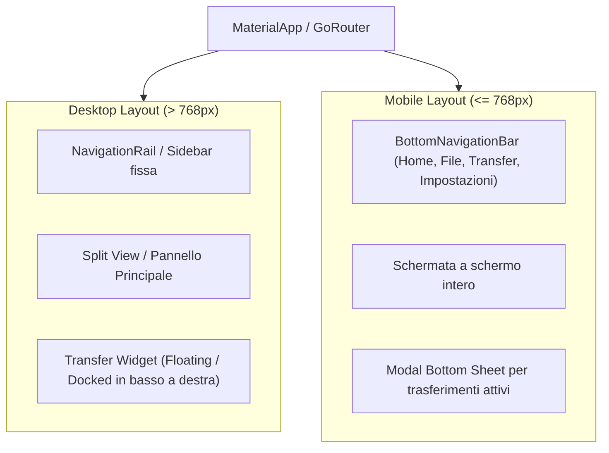
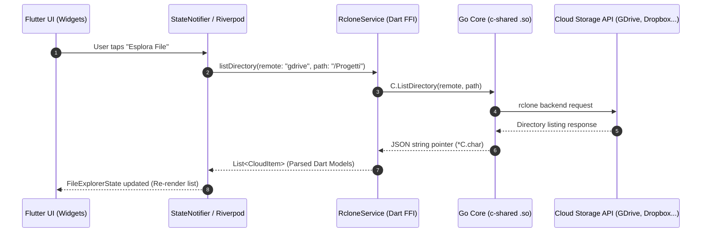

# Wireframe & Specifiche UI: Cloud Storage Unificata (`unifycloud`)

Questo documento definisce l'architettura dell'interfaccia utente, i flussi di navigazione e i wireframe (in formato visuale e schematizzato) per l'applicazione desktop e mobile multi-cloud.

---

## 1. Architettura della Navigazione & Layout Responsive

L'applicazione supporta sia piattaforme **Desktop (Linux, macOS, Windows)** che **Mobile (Android, iOS)** adottando un approccio responsive adattivo.



---

## 2. Schermate Principali

### 2.1. Schermata Home (Dashboard & Storage Overview)

#### Scopo:
Fornire una panoramica di tutti i servizi cloud configurati (Google Drive, Dropbox, OneDrive, WebDAV, SFTP, S3, ecc.), lo spazio totale e utilizzato aggregato, e l'accesso rapido per collegare nuovi account.

#### Wireframe ASCII:
```text
+-------------------------------------------------------------------------------+
| [Logo] UnifyCloud                                       [🔔 Sync]  [⚙ Impostazioni] |
+-------------------------------------------------------------------------------+
|                                                                               |
|  PANORAMICA STORAGE AGGREGATO                                                 |
|  +-------------------------------------------------------------------------+  |
|  |  Spazio Totale: 2.1 TB / 3.0 TB Occupati (70%)                          |  |
|  |  [█████████████████████████████████████████░░░░░░░░░░░░░]               |  |
|  |  • Google Drive: 850 GB   • Dropbox: 1.1 TB   • OneDrive: 150 GB         |  |
|  +-------------------------------------------------------------------------+  |
|                                                                               |
|  CLOUD COLLEGATI                                       [+ Collega Nuovo Cloud] |
|  +-------------------+  +-------------------+  +-------------------+          |
|  | [GDrive Icon]     |  | [Dropbox Icon]    |  | [OneDrive Icon]   |          |
|  | Google Drive      |  | Dropbox           |  | OneDrive          |          |
|  | mario@gmail.com   |  | mario.work@box.com|  | user@outlook.com  |          |
|  | 850 GB / 2 TB     |  | 1.1 TB / 2 TB     |  | 150 GB / 1 TB     |  [+ Altro]
|  | [Esplora File]    |  | [Esplora File]    |  | [Esplora File]    |          |
|  +-------------------+  +-------------------+  +-------------------+          |
|                                                                               |
|  ATTIVITÀ RECENTI / TRASFERIMENTI IN CORSO                                    |
|  • Upload: backup_2026.zip -> Google Drive (72% - 12.5 MB/s)                  |
|  • Sync completata: /Documenti/Fatture <-> Dropbox (2 min fa)                 |
+-------------------------------------------------------------------------------+
```

---

### 2.2. File Browser (File Explorer Multi-Cloud)

#### Scopo:
Navigare nelle cartelle di un singolo cloud o in una vista unificata. Supporta breadcrumb di percorso, visualizzazione a lista o griglia, filtri, ricerca immediata e menu contestuale.

#### Wireframe ASCII:
```text
+-------------------------------------------------------------------------------+
| [< Indietro] [Google Drive] > [Progetti] > [2026] > [Design]   [🔍 Cerca...]  |
+-------------------------------------------------------------------------------+
| [Vista: ☵ Lista | ▦ Griglia]   [⇅ Ordina: Nome ▾]   [+ Nuova Cartella] [⬆ Upload] |
+-------------------------------------------------------------------------------+
|  Nome                       Tipo        Dimensione      Ultima Modifica  Azioni|
|-------------------------------------------------------------------------------|
|  📁 Mockups/                Cartella    --              12/09/2026 14:20  [...] |
|  📁 Export/                 Cartella    --              10/09/2026 09:15  [...] |
|  📄 wireframe_v1.fig        Figma       48.2 MB         14/09/2026 17:00  [...] |
|  🖼 logo_unifycloud.svg     SVG         1.4 MB          13/09/2026 11:30  [...] |
|  📊 roadmap_progetto.pdf    PDF         820 KB          08/09/2026 18:45  [...] |
|  📝 note_meeting.md         Markdown    12 KB           05/09/2026 16:10  [...] |
|                                                                               |
|  [Menu Contestuale su click destro / long press (...)]:                       |
|  +-------------------------------------+                                      |
|  | ⬇ Scarica in locale                 |                                      |
|  | 📋 Copia verso un altro Cloud...    |                                      |
|  | ✂ Sposta                           |                                      |
|  | ✏ Rinomina                          |                                      |
|  | 🔗 Genera link di condivisione      |                                      |
|  | 🗑 Elimina                          |                                      |
|  +-------------------------------------+                                      |
+-------------------------------------------------------------------------------+
| 6 elementi  |  1 elemento selezionato (48.2 MB)           [Trasferimenti: 1 ▲]|
+-------------------------------------------------------------------------------+
```

---

### 2.3. Transfer Manager (Coda Trasferimenti & Monitor di Progresso)

#### Scopo:
Monitorare tutte le operazioni attive e completate: upload dal dispositivo, download, e copia/sincronizzazione diretta server-to-server tra cloud diversi abilitata dal motore Go/Rclone.

#### Wireframe ASCII:
```text
+-------------------------------------------------------------------------------+
| TRASFERIMENTI ATTIVI & CRONOLOGIA                     [Svuota Completati] [⏸ Pausa Tutti] |
+-------------------------------------------------------------------------------+
|                                                                               |
|  IN CORSO (2)                                                                 |
|  +-------------------------------------------------------------------------+  |
|  |  ▲ UPLOAD: video_presentazione.mp4 -> Google Drive                      |  |
|  |  340 MB di 1.2 GB (28%)  •  Velocità: 15.4 MB/s  •  ETA: 55s            |  |
|  |  [████████████░░░░░░░░░░░░░░░░░░░░░░░░░░░░░░░░░░░░░░░░░]                 |  |
|  |                                                [⏸ Pausa]  [✖ Annulla]   |  |
|  +-------------------------------------------------------------------------+  |
|  |  ⇄ CLOUD SYNC: /Archivio2025 (Dropbox -> OneDrive)                      |  |
|  |  4.8 GB di 5.0 GB (96%)  •  Velocità: 45.2 MB/s  •  ETA: 4s             |  |
|  |  [████████████████████████████████████████████░░░░░░░░░]                 |  |
|  |                                                [⏸ Pausa]  [✖ Annulla]   |  |
|  +-------------------------------------------------------------------------+  |
|                                                                               |
|  COMPLETATI RECENTEMENTE                                                      |
|  •  ✔ report_fiscale.pdf (Download da OneDrive) • 2.4 MB • Completato 10m fa  |
|  •  ✔ cartella_foto/ (Upload su Google Drive) • 850 MB • Completato 1h fa     |
|                                                                               |
|  ERRORI / DA RIPETERE                                                         |
|  •  ⚠ raw_footage_01.mov: Errore timeout connessione.       [🔄 Riprova]       |
+-------------------------------------------------------------------------------+
```

---

### 2.4. Impostazioni (Configurazione, Autenticazione & Sicurezza)

#### Scopo:
Gestire le chiavi API dei provider, la sicurezza dei token (integrazione con Keystore Android e Keychain iOS/macOS via `flutter_secure_storage`), i limiti di banda e le preferenze grafiche.

#### Wireframe ASCII:
```text
+-------------------------------------------------------------------------------+
| [←] IMPOSTAZIONI                                                              |
+-------------------------------------------------------------------------------+
|  ACCOUNT & CLOUD                                                              |
|  • Gestione Provider Configurati (Token OAuth2, Refresh, Logout)              |
|  • Crittografia configurazione rclone.conf (Archiviazione protetta)           |
|                                                                               |
|  RETE & LIMITI DI TRASFERIMENTO                                               |
|  • Limite Velocità Download: [ Illimitato        ▾ ]                          |
|  • Limite Velocità Upload:   [ 10 MB/s           ▾ ]                          |
|  • Trasferimenti simultanei: [ 4                 ▾ ]                          |
|  • Consenti trasferimenti solo sotto rete Wi-Fi: [ ON / [X] ]                 |
|                                                                               |
|  CACHE & SPAZIO LOCALE                                                        |
|  • Posizione Cache Locale: /var/home/.../unifycloud_cache     [Sfoglia...]    |
|  • Dimensione Cache: 450 MB usati                             [Svuota Cache]  |
|                                                                               |
|  ASPETTO & APPLICAZIONE                                                       |
|  • Tema: ( ) Chiaro  (•) Scuro  ( ) Segui Sistema                             |
|  • Lingua: Italiano (IT)                                                      |
|  • Versione: 0.1.0 (Core Rclone Go: v1.68)                                    |
+-------------------------------------------------------------------------------+
```

---

## 3. Flusso Dati & Stato (Riverpod + FFI)



